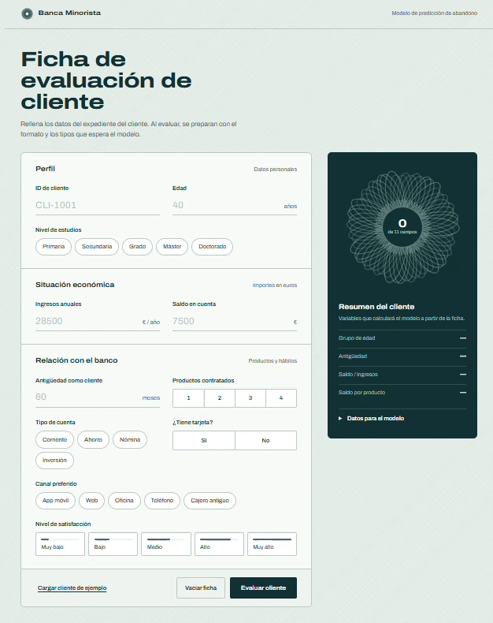
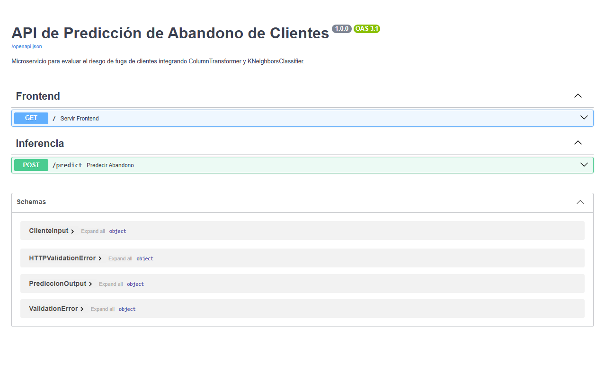

# Predicción de abandono de clientes

Aplicación web que predice si un cliente del banco **abandonará o no** a partir de sus datos. Usa un modelo **KNN (K vecinos más cercanos)** entrenado con un dataframe de clientes.

## 🚀 Demo en línea

La web está desplegada en **Render**:

👉 **[Abrir la aplicación](ENLACE_A_RENDER)**

Basta con entrar al enlace para usar la interfaz: rellenar los campos del cliente y obtener la predicción.

## 🖥️ Cómo se usa

1. Rellena los campos del formulario con los datos del cliente.
2. Pulsa el botón **Evaluar cliente**.
3. La web muestra si el cliente **abandonará o no** y la **probabilidad de abandono** en porcentaje.



### Formato de los datos

El único campo con un formato concreto es el **ID del cliente**, que debe escribirse así:

```
CLI-1234
```

Es decir, `CLI-` seguido de 4 números.

### Probar con un cliente de ejemplo

Para hacer una prueba rápida, pulsa **Cargar cliente de ejemplo**: se rellenan todos los campos automáticamente y ya puedes pulsar **Evaluar cliente**.

## 📄 Documentación de la API

En la ruta **`/docs`** está la documentación interactiva de la API (Swagger), desde donde también se pueden probar las peticiones directamente.



## 🧰 Tecnologías

- **Python** con **FastAPI** y **Uvicorn** para la API
- **scikit-learn** (KNN y `ColumnTransformer`), **pandas** y **joblib** para el modelo
- **HTML**, **CSS** y **JavaScript** para la interfaz
- **Render** para el despliegue

## 💻 Ejecutar en local

```bash
python -m venv .venv
.venv\Scripts\activate          # En Windows
pip install -r requirements.txt
python -m uvicorn main:app --reload --port 8000
```

Después abre **http://127.0.0.1:8000** en el navegador.
